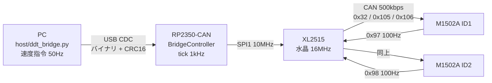
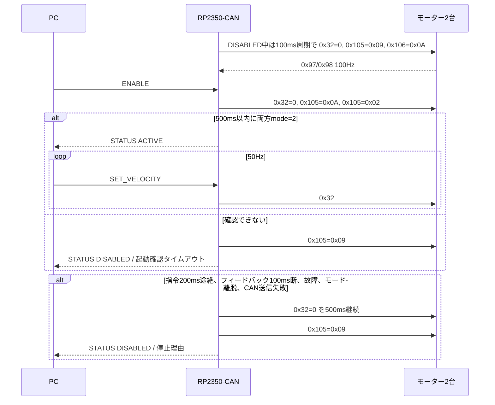
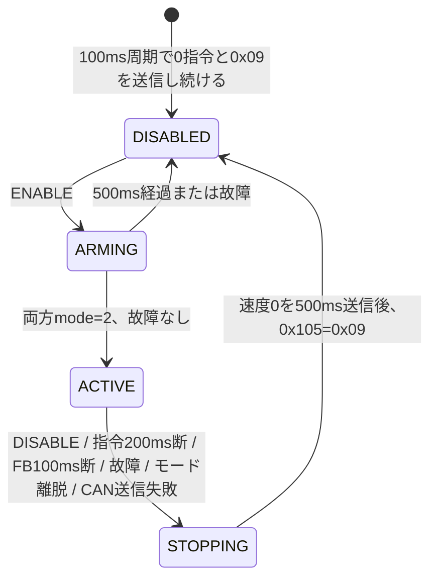
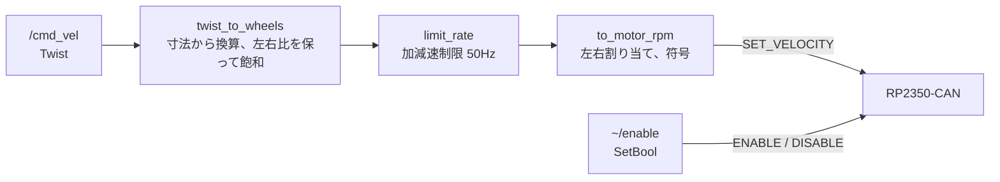

# PC ⇔ RP2350-CAN ⇔ DDT M1502A 中継 設計書

## 1. 目的

PCからUSB経由で2台のDDTモーターへ速度指令を送り、状態を受け取る。
異常時にマイコン側で確実に停止する。

## 2. システム構成

新規構築のため、現状構成は無い。

## 3. 追加部分

全体が新規なので2章と同じ。24Vはモーターのみに供給し、基板はUSB給電とする。

## 4. メッセージ仕様

### 4.1 USBフレーム

| オフセット | サイズ | 内容 |
|---|---|---|
| 0 | 2 | ヘッダ `AA 55` |
| 2 | 1 | 種別 |
| 3 | 1 | ペイロード長（最大16） |
| 4 | N | ペイロード（リトルエンディアン） |
| 4+N | 2 | CRC16-CCITT-FALSE（種別〜ペイロード、リトルエンディアン） |

| 種別 | 向き | 名前 | ペイロード | 周期 |
|---|---|---|---|---|
| `0x01` | PC→基板 | ENABLE | なし | 必要時 |
| `0x02` | PC→基板 | DISABLE | なし | 必要時 |
| `0x03` | PC→基板 | SET_VELOCITY | `int16 rpm_id1`, `int16 rpm_id2` | 50Hz推奨、200ms以内必須 |
| `0x81` | 基板→PC | FEEDBACK | `u8 id`, `i16 rpm`, `i16 current_raw`, `u16 angle_raw`, `u8 fault`, `u8 mode` | 各100Hz |
| `0x82` | 基板→PC | STATUS | `u8 state`, `u8 stop_reason` | 10Hz |
| `0x83` | 基板→PC | ERROR | `u8 error_code` | 発生時 |

`state`: 0=DISABLED, 1=ARMING, 2=ACTIVE, 3=STOPPING

`stop_reason`: 0=なし, 1=DISABLE要求, 2=指令タイムアウト, 3=フィードバック断, 4=モーター故障, 5=起動確認タイムアウト, 6=CAN送信失敗, 7=速度モード離脱

`error_code`: 1=CRC不一致, 2=不正な長さ, 3=速度範囲外, 4=未知の種別, 5=状態不正, 6=CAN送信タイムアウト

### 4.2 CAN（500kbps、標準フレーム、DLC 8、ビッグエンディアン）

| ID | 向き | 内容 | 周期 |
|---|---|---|---|
| `0x32` | 基板→モーター | ID1〜4の目標速度 `i16`×4。ID3、4は0 | 50Hz（ARMING、ACTIVE、STOPPING時）、10Hz（DISABLED時は0） |
| `0x105` | 基板→モーター | モード。`0x0A`有効、`0x02`速度、`0x09`無効 | 状態遷移時、10Hz（DISABLED時は`0x09`） |
| `0x106` | 基板→モーター | 報告方式。`0x0A`=能動報告10ms | 10Hz（DISABLED時） |
| `0x97`, `0x98` | モーター→基板 | 速度、電流、角度、故障、モード | 100Hz |
| `0x201`, `0x202` | モーター→基板 | `0x105`の応答 | 受信のみ、未使用 |
| `0x265`, `0x266` | モーター→基板 | `0x106`の応答 | 受信のみ、未使用 |

## 5. シーケンス

## 6. 状態遷移

停止後に自動復帰はしない。再開にはENABLEが必要で、ACTIVEへの遷移時の目標速度は0とする。
ファームのハングは100msのハードウェアウォッチドッグでリセットし、起動直後から周期送信で無効化する。
速度指令は最新値のみ保持して古い指令の遅延送信を防ぐ。`0x09`は未送信の設定フレームより優先する。
回転中のBOOTSEL遷移を防ぐため、USB経由のリセットは無効で、書き込みにはBOOTボタンが必要。

## 7. 実装タスク

1. `pc_protocol`: USBフレームのエンコードとストリームパーサ（単体テスト）
2. `motor_protocol`: CANフレームの生成と解析（単体テスト）
3. `bridge_controller`: 状態機械（単体テスト）
4. `xl2515`: SPIドライバ。Waveshareのデモは受信ID固定のため流用せず、16MHz/500kbpsの`CNF1..3 = 00 9E 03`のみ採用値として確認
5. `main`: USB、CAN、制御の非ブロッキングループ
6. `host/ddt_bridge.py`: 標準ライブラリのみのPCクライアント

## 8. ROS 2ノード

`ros2/ddt_diff_drive` の `diff_drive_node` は `/cmd_vel` を受け、50Hzで `SET_VELOCITY` を送る。

- 起動時は無効で、`~/enable` を呼ぶまで指令を送らない。
- `/joy` のボタンでも `~/enable` 相当を行う（立ち上がり検出、デッドマンと中立の条件つき、有効化の待ちは制御タイマで行いブロックしない）。無効化は条件なし。
- `/cmd_vel` が `command_timeout_s` 途絶えると、加減速制限に従って0へ下げる。
- ファームが停止したら出力を0に戻す。再開には `~/enable` が必要で、0から加速する。
- モーター内部に速度ループがあるので、ROS側に速度PIDは持たない。
- ノードが落ちた場合はファームの指令タイムアウト（200ms）で止まる。
- このMacではDocker DesktopがUDP 7400（ドメイン0）を占有しているため、`ROS_DOMAIN_ID=42` とする。

## 9. 懸念事項

- **型番の差:** プロトコルはM15シリーズ（M1502D）資料に基づく。M1502Aでの実機確認が必要。
- **モーターID:** ID1、ID2に設定済みである前提。インジケーターの緑点滅回数で確認する。出荷時に同じIDの2台を同一バスに繋ぐとIDが衝突する。ID変更手順は資料の未読部分も含めて未確認。
- **モーター側の指令途絶保護:** 確認できていない。マイコン側の停止で担保し、基板リセット時の挙動は実機で確認する。
- **`0x09`後は惰行の可能性:** 無効化後の保持力は未確認。傾斜面では動き得る。
- **ACK不在:** モーター未接続だとTXREQが解除されない。100msで送信を中止してエラーを報告する。
- **バス負荷（概算、1フレーム125bit）:** フィードバック 200フレーム/s + 指令 50フレーム/s = 31kbps、約6%。既定の1kHz報告のままだと2台で約50%になるため起動時に変更する。
- **故障の扱い:** 警告相当の低電圧1（`0x01`）や過熱1（`0x1E`）でも停止する。走行時に電圧降下で止まる場合は閾値を見直す。
- **非絶縁CAN:** GNDを共通化する。PC保護のためUSBアイソレータを推奨。
- **終端抵抗:** モーター内蔵の有無は未確認。電源オフでCANH-CANL間を測定し、約60Ωになるよう基板のSW1を設定する。
- **USB切断（重大）:** 基板はUSB給電なので、ケーブルが抜けると基板ごと落ちて停止処理を実行できない。モーターが指令を保持する場合は回り続けるため、**24Vを遮断する物理的な非常停止が必須**。指令途絶として止められるのは、基板に給電が続く場合（PCプログラムの異常終了など）に限る。USB出力タイムアウトは制御を遅らせないよう2msに短縮している。
- **パーサの再同期:** 長さが壊れたフレームは後続を巻き込むことがある。DISABLEが失われても指令タイムアウトで止まるため許容している。
- **速度上限:** `MAX_VELOCITY_RPM`は指令範囲いっぱいの210rpm。定格115rpmを超え、無負荷回転速度（210±10rpm）に近いので、過速度故障（`0x14`）や電圧不足で届かない可能性がある。
- **反転:** 左右で回転方向が逆になる場合の符号補正はPC側で行う。
